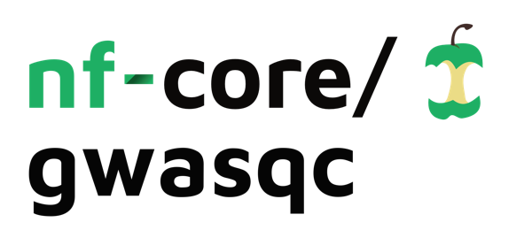

<h1>
  <picture>
    <source media="(prefers-color-scheme: dark)" srcset="docs/images/nf-core-gwasqc_logo_dark.png">
    
  </picture>
</h1>

[](https://github.com/codespaces/new/nf-core/gwasqc)
[](https://github.com/nf-core/gwasqc/actions/workflows/nf-test.yml)
[](https://github.com/nf-core/gwasqc/actions/workflows/linting.yml)[](https://nf-co.re/gwasqc/results)[](https://doi.org/10.5281/zenodo.XXXXXXX)
[](https://www.nf-test.com)

[](https://www.nextflow.io/)
[](https://github.com/nf-core/tools/releases/tag/4.0.3)
[](https://docs.conda.io/en/latest/)
[](https://www.docker.com/)
[](https://sylabs.io/docs/)
[](https://cloud.seqera.io/launch?pipeline=https://github.com/nf-core/gwasqc)

[](https://nfcore.slack.com/channels/gwasqc)[](https://bsky.app/profile/nf-co.re)[](https://mstdn.science/@nf_core)[](https://www.youtube.com/c/nf-core)

## Introduction

**nf-core/gwasqc** is a bioinformatics pipeline that quality-controls genotype array data. It takes a samplesheet of PLINK 1 bed/bim/fam filesets — one row per stratum, typically one ancestry group of a cohort, each quality-controlled independently — and runs the variant and sample checks of a standard pre-GWAS workflow on each of them: minor allele frequency, missingness, Hardy-Weinberg equilibrium, LD pruning, sex concordance, heterozygosity, [KING](https://doi.org/10.1093/bioinformatics/btq559) relatedness and ancestry inference against a labelled reference panel.

Every check runs on the unfiltered fileset with the decision lists accumulated so far applied by [PLINK 2](https://www.cog-genomics.org/plink/2.0/), so each statistic describes the filtered data without an intermediate fileset being written. What comes out is one QC'd bed/bim/fam fileset per stratum, written exactly once; every decision list and statistics table beside the statistic it was derived from; a cross-stratum summary table; and a [MultiQC](http://multiqc.info/) report with one section per stage and the review figures of every stratum.

## Pipeline summary

1. Minor allele frequency keep-list over every variant (`plink2 --maf` with `--write-snplist`)
2. Missingness ([`plink2 --missing`](https://www.cog-genomics.org/plink/2.0/basic_stats#missing)): a per-variant report over the MAF-passing variants and the `--geno` exclusion list from it, then a second report with that list excluded and the `--mind` removal list from it, plus a call-rate ladder from 90 % to 99 % recording what each rate would remove
3. Hardy-Weinberg equilibrium ([`plink2 --hardy`](https://www.cog-genomics.org/plink/2.0/basic_stats#hardy)) with an exclusion list at the `--hwe` p-value floor, autosomal and chromosome X read together
4. LD pruning over every chromosome ([`plink2 --indep-pairwise`](https://www.cog-genomics.org/plink/2.0/ld#indep)), then an exclusion list of the pruned variants that lie in a long-range LD region or off chromosomes 1 to 22
5. Sex check on the pruned set ([`plink2 --check-sex`](https://www.cog-genomics.org/plink/2.0/basic_stats#check_sex)), with the chromosome X pseudo-autosomal regions split off by `--split-par` in the same run, a mismatch table and a removal list
6. Heterozygosity ([`plink2 --het`](https://www.cog-genomics.org/plink/2.0/basic_stats#het)) on the pruned autosomal set outside the long-range LD regions, report only: no threshold is applied and no sample is listed
7. KING-robust relatedness ([`plink2 --make-king-table`](https://www.cog-genomics.org/plink/2.0/distance#make_king)) with the pairs classified by degree, one member of each duplicate/MZ pair listed for removal and a mean-kinship outlier list
8. Ancestry inference against the reference panel: each reference fileset is restricted to the stratum's QC'd variants, harmonised onto its strand and merged, then pruned, decomposed ([`plink2 --pca allele-wts`](https://www.cog-genomics.org/plink/2.0/strat#pca)) and projected; a linear discriminant classifier trained on the panel's super-population labels assigns every study sample, and the samples not assigned to the stratum's own label become a mismatch list
9. One terminal `plink2 --make-bed` writes the QC'd fileset from the original fileset and the complete list set — the only fileset the pipeline materialises for a stratum
10. Reporting: a per-stratum summary row and figure set, the cross-stratum `gwasqc_summary.tsv` at the run root, and a [`MultiQC`](http://multiqc.info/) report built entirely from those published tables and figures

## Usage

> [!NOTE]
> If you are new to Nextflow and nf-core, please refer to [this page](https://nf-co.re/docs/get_started/environment_setup/overview) on how to set-up Nextflow. Make sure to [test your setup](https://nf-co.re/docs/get_started/run-your-first-pipeline) with `-profile test` before running the workflow on actual data.

First, prepare a samplesheet with one row per stratum, where a stratum is a PLINK 1 bed/bim/fam fileset that is quality-controlled on its own:

```csv title="samplesheet.csv"
id,ancestry,bed,bim,fam
cohort_eur,EUR,/path/to/genotypes/cohort_eur.bed,/path/to/genotypes/cohort_eur.bim,/path/to/genotypes/cohort_eur.fam
cohort_afr,AFR,/path/to/genotypes/cohort_afr.bed,/path/to/genotypes/cohort_afr.bim,/path/to/genotypes/cohort_afr.fam
```

Then declare the ancestry reference panel, one row per PLINK 1 fileset — a whole-genome panel is one row, a per-chromosome panel one row per chromosome — alongside a tab-separated table labelling every reference sample with `FID`, `IID`, `pop` and `super_pop`:

```csv title="reference_panel.csv"
id,bed,bim,fam
chr1,/path/to/reference/1KG_Phase3.chr1.bed,/path/to/reference/1KG_Phase3.chr1.bim,/path/to/reference/1KG_Phase3.chr1.fam
chr2,/path/to/reference/1KG_Phase3.chr2.bed,/path/to/reference/1KG_Phase3.chr2.bim,/path/to/reference/1KG_Phase3.chr2.fam
```

Now, you can run the pipeline using:

```bash
nextflow run nf-core/gwasqc \
   -profile <docker/singularity/.../institute> \
   --input samplesheet.csv \
   --reference_panel reference_panel.csv \
   --reference_pop_data ref_pop.tsv \
   --outdir <OUTDIR>
```

`--skip_ancestry` leaves the ancestry stage out, and `--reference_panel` and `--reference_pop_data` are then not needed.

> [!WARNING]
> Please provide pipeline parameters via the CLI or Nextflow `-params-file` option. Custom config files including those provided by the `-c` Nextflow option can be used to provide any configuration _**except for parameters**_; see [docs](https://nf-co.re/docs/running/run-pipelines#using-parameter-files).

For more details and further functionality, please refer to the [usage documentation](https://nf-co.re/gwasqc/usage) and the [parameter documentation](https://nf-co.re/gwasqc/parameters).

## Scope

This release implements the PLINK-format route only: bed/bim/fam in, a QC'd bed/bim/fam fileset out. A pgen/pvar/psam fileset passes through the same module interfaces unconverted, because every plink2 module selects `--bfile` or `--pfile` from the staged extension, but that route is untested and undeclared by the samplesheet schema. The VCZ format route is deliberately deferred to its own issue: its ingestion, representation and tool layer differ from the PLINK route, and nothing here is built for it. Pre-QC batch merging is out of scope and is not part of this pipeline.

Only the missingness removals are applied to the QC'd fileset by default, as in the pipeline this one ports. Every other sample decision — the sex mismatches, one member of each duplicate/MZ pair, the ancestry mismatches — is published as a removal list and reaches the fileset only with `--apply_sample_removals`; the mean-kinship outlier list is published and never applied, and heterozygosity produces no list at all.

## Legacy pipeline

The directory `GLAD_EDGI_NBR_qc_workflows/` is the read-only archive of the legacy GLAD/EDGI/NBR bash and R genotype QC pipeline that this pipeline ports. It is kept as the historical reference for the port and nothing in it is executed by, or reachable from, this pipeline.

## Pipeline output

To see the results of an example test run with a full size dataset refer to the [results](https://nf-co.re/gwasqc/results) tab on the nf-core website pipeline page.
For more details about the output files and reports, please refer to the
[output documentation](https://nf-co.re/gwasqc/output).

## Credits

nf-core/gwasqc was originally written by Yuhao Lin.

## Contributions and Support

If you would like to contribute to this pipeline, please see the [contributing guidelines](docs/CONTRIBUTING.md).

For further information or help, don't hesitate to get in touch on the [Slack `#gwasqc` channel](https://nfcore.slack.com/channels/gwasqc) (you can join with [this invite](https://nf-co.re/join/slack)).

## Citations

An extensive list of references for the tools used by the pipeline can be found in the [`CITATIONS.md`](CITATIONS.md) file.

You can cite the `nf-core` publication as follows:

> **The nf-core framework for community-curated bioinformatics pipelines.**
>
> Philip Ewels, Alexander Peltzer, Sven Fillinger, Harshil Patel, Johannes Alneberg, Andreas Wilm, Maxime Ulysse Garcia, Paolo Di Tommaso & Sven Nahnsen.
>
> _Nat Biotechnol._ 2020 Feb 13. doi: [10.1038/s41587-020-0439-x](https://dx.doi.org/10.1038/s41587-020-0439-x).
